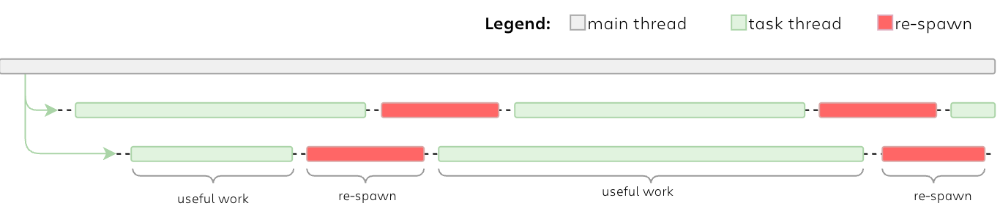
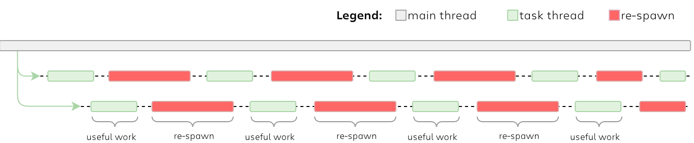
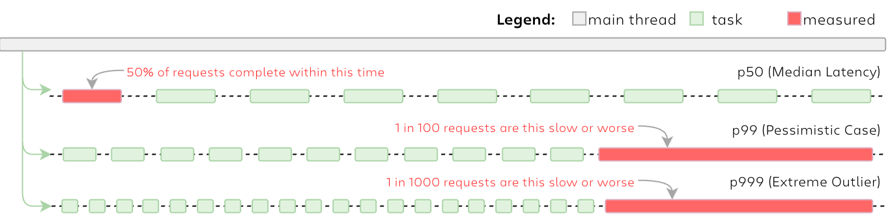

# The Cost of Concurrency and Parallelism

Many of the developers and engineers, especially younger generation used to use concurrency in their projects as is - just throw a thread, join it at the end, then destroy. More experiences guys use threadpool, which doesn't kill threads and doesn't waste time on their re-initializing. Seniors and staff guys probably knows that it's not that obvious under the hood, and that's what we would like to examine to reveal for making more pragmatic choice while using multithreading, concurrency and parallelism in general.

If we take a look around, most of the benchmarks use prepared workflows which usually are well enough to be parallelized, meaning that data is isolated, algorithms are never changed and there is no direct impact on datasets in different threads. This is what is called ideal conditions - we all know them and definitely use threading as we can see there real impact on our efficiency and it is positive. Under such circumstances the problem is almost invisible and negligible. 

However the data is not always prepared and in many variations it became so small that spawning the thread, queuing a job, waking a worker, makes application working with threading slower enough to be considered and surprisingly may lead to worse performance with enabled concurrency than without it.

I prepared few test cases to find out all of this machinery and measure its impact.

My goal is to measure and quantify the pure overhead of different concurrency approaches - raw thread creation and join, a simple thread pool with work-stealing and lock-based queues, as well as some higher-level abstractions like `async`. In this case, by isolating the costs of thread startup, context switches, cache bouncing and memory barriers with the cost of synchronizing primitives, I can draw a simple decision boundary - at which point concurrency stops giving benefits and brings more problems. Results should help to decide whether to stay sequential, go async, use a thread pool, or invest in more sophisticated technics.

## The First Workload - CPU only

The work itself is always the same and it's very CPU intense (for the first round - later I'll make other ops tested, like IO, mixed load, etc.). I have ten thousand terms of the Leibniz series for $π$, which is a perfect pure computation with a tight floating-point loop. Usually it finishes in a couple of microseconds, but that's the point - it’s small enough to understand whether it worths to start a job sequentially or throw it concurrently, because the compiler have to do some extra job for that. This is exactly the regime where all the dispatch machinery suddenly becomes visible.

However don't read this as a CPU benchmark. The π loop is only a good known fixed payload which has minimal size of the side effects. I'm measuring the only cost of spawning a thread, pushing a job onto a queue, then getting work from another core thus waking another worker, and to make it more clean I need to minimize any size effects which may give unpredictable and unreproducible results. In this picture the arithmetic becomes just the minimal work without any side effects and nothing more - pure calculations without going back and forth with IO, networking or something else.

Getting such a workload, small enough, run in microseconds, but repeated multiple times one after another by pulling each one from the queue, I set the goal to check - how fast overall queue would be cleaned up from those jobs (to calculate $π$).

Each measurement fires a hundred of these tasks through one concurrency primitive and waits until all hundred are done. That full fan-out counts as one sample. Every variant gets a single warm-up fan-out first - to warm the instruction cache, the branch predictors, and, when a pool is involved, to make sure the workers are actually created before the clock starts - and then a thousand timed samples.

## How to Read the Numbers

A mean value would be definitely wrong here. Dispatch cost isn't a single value, it's a distribution with a tail, and the tail is actually where I can catch some interesting failures. There might be a run that hit a scheduler hiccup, or another one which caught a collector mid-sweep, or the one that was thrown onto a slow core. Every variant is reported as three points on its distribution: **p50** (the median - the typical run), **p99**(the bad-but-not-rare run), and **p999** (the worst run in roughly a thousand). With a thousand samples, p999 gets landing on rank ~998 - but it's a genuine one-in-a-thousand observation, not a synonym for "the slowest sample." When p999 pulls far away from p50 then something intermittent fell into the measurement and naming that something - whether it was a GC pause, or a clock transition, or a cold pool - is most of the work of the later articles.

One methodological note that matters. A loop whose result is never used, is a loop which a good optimizer is entitled to delete, and with a flag `--release` Rust will absolutely do that as part of its optimization, as leaving you a workload for just an empty fan-out is a glorious nonsense. Thus each of the variant here wraps each task's result into a single global accumulator (simple XOR of the raw float bits) at the very end. At the same time that accumulator does a second job as it keeps every `print` out of the timed region to minimize side effects on IO operations to console - I don't want to make a benchmark of `stdout`.

## What I Can't Control For

My working machine is Apple M5 Pro, and Apple silicon don't use a CPU governor, so I can't pin the clocks, I can't disable boost, and it's not possible to stop the scheduler from migrating a task between performance cores and super cores. That's another reason for p99 and p999 measurements - as a task that lands on an  performance core, shows up as a p99 or p999 tail that came from the machine, not from the runtime.

Unfortunately I don't have a Linux box under my desk, so I can't run those tests on Linux and the same is true for Windows (I happily breathed out when I switched on Mac in 2008 - sorry Bill), but I share all the code in my GitHub repository so anyone may examine it, repeat tests and make his own measurement. Pure experiment, promising to become exciting and brings the same exciting results.

## Test Environment

All measurements were taken on a single machine, cold-start: one warm-up run, then 1000 timed fan-outs per variant. No warm/cold matrix, no cache manipulation.

| Keys        | Values                                      |
| ----------- | ------------------------------------------- |
| **Machine** | MacBook Pro (Mac17,9), Apple M5 Pro         |
| **Cores**   | 15 (5 Super and 10 Performance)             |
| **Memory**  | 24 GB                                       |
| **OS**      | macOS 26.6.2 (25G83) (Darwin 25.6.0 kernel) |

### Runtimes (exact, pinned)

| Language | Version                                                                             | Build / flags          |
| -------- | ----------------------------------------------------------------------------------- | ---------------------- |
| Rust     | rustc 1.98.1 (48a229cea 2026-09-01)                                                 | `--release`            |
| Go       | go version go1.27.1 darwin/arm64                                                    | default toolchain      |
| Node.js  | v24.20.0 (npm v11.19.0)                                                             | worker_threads         |
| Python   | Python 3.14.6 free-threading build [Clang 22.1.3 ] Python 3.14.6 [Clang 22.1.3 ] | 3.14t                  |
| Java     | Oracle JDK 25.0.3 (25.0.3+9-LTS-195)                                                | G1 GC, `-Xms2g -Xmx2g` |

## Next Step

Rust comes first because it gives me the cleanest baseline (and that's what I know better than C). It has such features like ahead-of-time compiled, no garbage collector, no interpreter loop - there's nothing between the code and the scheduler. The numbers I measure here are purely dispatch cost, but nothing else. All of these makes Rust the best starting point - once I know the cost a hundred tiny tasks through raw threads, through rayon, through a thread pool, and through an async runtime, I can do the same and compare with Go's scheduler, Java's JIT and its GC tail, Python's interpreter, and Node's runtime.
