# A Computer Inside Your Computer

*How to create a virtual machine with VirtualBox and install Ubuntu 26.04 LTS in it, the first part of a three-part series for CST8277 Enterprise Application Programming.*

This is Part 1 of 3. [Part 2](Part%202%20-%20A%20Kubernetes%20Cluster%20of%20Your%20Own.md) turns the machine built here into a Kubernetes cluster, and [Part 3](Part%203%20-%20From%20Source%20Code%20to%20a%20Running%20Pod.md) writes a small Spring Boot service and runs it on that cluster.

## 1. Why we begin with an empty machine

In the second or third week of almost every programming course that asks students to run real infrastructure, the room divides in two. Half the class has a working setup and has already moved on to the exercise, while the other half is staring at an error that mentions a port already in use, a library of the wrong version, or a permission that some earlier, half-remembered installation quietly changed. The code on both sides of the room is usually identical, which means the difference lies underneath it, in the layers of software that each laptop has accumulated over the years and that nobody in the room can fully describe.

The remedy this series adopts is to stop installing course software on your own computer at all and to build, instead, a second computer that lives inside the first. That second computer, a virtual machine, starts completely empty, receives exactly the tools the course needs and nothing else, and behaves the same way on a Windows laptop, a MacBook, and a Linux desktop. If it is ever damaged beyond repair, it can be deleted and rebuilt in under an hour without touching a single file of your own, a freedom that makes it much easier to experiment, to break things on purpose, and to learn from what breaks.

Figure 1 shows the whole environment that the three articles of this series assemble. The outer frame is your own computer, which from now on we call the host. Inside it runs VirtualBox, and inside VirtualBox runs a virtual machine with Ubuntu Linux, which will in turn hold a Java toolchain, Docker, an IDE, a browser, and a small Kubernetes cluster that runs our application. This first article builds the two outer layers, the hypervisor and the operating system, and leaves the rest of the picture for the parts that follow.

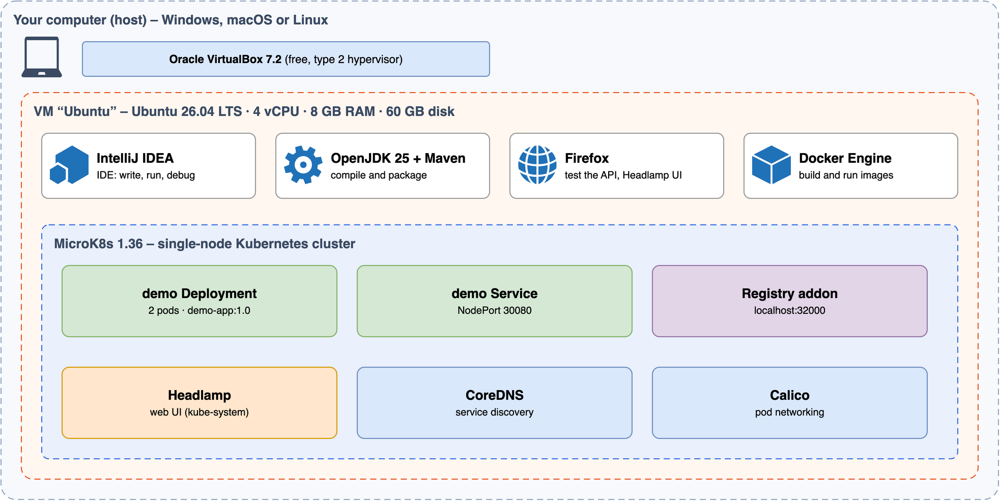

*Figure 1. The complete lab environment, in which VirtualBox on your own computer hosts a single Ubuntu virtual machine that contains every tool and the Kubernetes cluster used for the rest of the course.*

The work is divided into eight steps, which Figure 2 lays out in order. This article covers the first two, installing VirtualBox and creating the Ubuntu virtual machine, [Part 2](Part%202%20-%20A%20Kubernetes%20Cluster%20of%20Your%20Own.md) covers the third, and [Part 3](Part%203%20-%20From%20Source%20Code%20to%20a%20Running%20Pod.md) covers the remaining five. Each step ends with a small check, such as a version number, a login screen, or an HTTP response, so that a problem is caught in the step that caused it rather than three steps later, when its cause has become much harder to find.

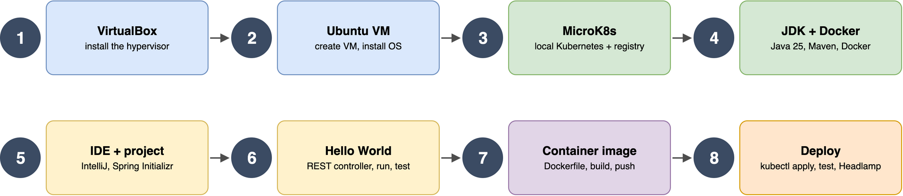

*Figure 2. The eight steps of the series, of which this article covers the first two.*

The environment is not a throwaway exercise. Every later module of the course, from security to debugging, continuous delivery, and observability, reuses this machine, so the time spent building it carefully now is repaid many times over.

## 2. What a virtual machine is

### 2.1 A computer simulated in software

A virtual machine, usually shortened to VM, is a computer whose processor, memory, disk, network card, and screen are provided by a program rather than by physical hardware. The operating system installed inside it, which is called the guest, believes it is running on an ordinary computer, boots from what it takes to be a DVD, writes to what it takes to be a hard disk, and talks to what it takes to be a network. All of those devices are in fact files and processes managed by a program on the host, and that program is called a hypervisor.

Hypervisors come in two broad kinds. A type 1 hypervisor runs directly on the hardware in place of an ordinary operating system, as happens in the data centers of cloud providers, whereas a type 2 hypervisor runs as an application on top of the operating system you already use, next to your browser and your editor. VirtualBox, a free and open-source hypervisor maintained by Oracle, belongs to the second kind, which is exactly what a student laptop needs, because it can be installed and removed like any other program.

The image of a computer inside a computer is accurate in one important respect and misleading in another. It is accurate because the guest is genuinely isolated, so that nothing you install or delete inside Ubuntu can damage the files of your host. It is misleading if it suggests that the guest has resources of its own, because every virtual processor and every gigabyte of virtual memory is borrowed from the host for as long as the VM runs. A VM given too much starves the host, and a VM given too little crawls, which is why the next section is about choosing those numbers carefully.

### 2.2 How much of your computer to lend

A good rule is to give the VM about half of your computer's resources. The setup used throughout this series assigns 4 processor cores, 8 GB of memory, and 60 GB of disk space, which leaves enough room for Kubernetes, Docker, and an IDE to run at the same time without long pauses. The environment also works, though noticeably more slowly, with 2 cores, 6 GB of memory, and 40 GB of disk, which is the practical minimum. The disk figure is less frightening than it looks, because, as we shall see, the virtual disk occupies only as much real space as the guest has actually written.

### 2.3 Two kinds of processor, two editions of Ubuntu

The last decision to make before downloading anything concerns the processor in your computer. VirtualBox 7.2 supports both the Intel and AMD processors found in most Windows and Linux computers and the Apple silicon chips found in recent Macs, but these two families speak different machine languages, and a guest operating system must be built for the language of the host. On an Apple silicon Mac you therefore need the ARM64 edition of Ubuntu, while on every other computer you need the AMD64 edition. The screenshots in this series were taken on an Apple silicon Mac and so show ARM64 file names, but every command and every screen of the installer is identical on AMD64.

## 3. Creating the virtual machine

### 3.1 Two downloads

Two files are needed before VirtualBox can create anything. The first is VirtualBox itself, which you download for your operating system from [virtualbox.org](https://www.virtualbox.org/wiki/Downloads) and install with the default options, since it is free for personal and educational use. The second is the Ubuntu 26.04 LTS desktop installer, distributed as an ISO image, a single file that contains a complete copy of an installation DVD, which you download from [ubuntu.com/download/desktop](https://ubuntu.com/download/desktop). LTS stands for Long Term Support, a promise that Canonical, the company behind Ubuntu, will publish security updates for this release for at least five years, which is why LTS releases are the usual choice for servers and for a course that should not change under its students' feet.

VirtualBox is not the only possible host for the VM. VMware Workstation Pro and VMware Fusion Pro are also free for personal use, and Parallels Desktop is a common choice on Macs, so anyone who already uses one of them can keep it, since the Ubuntu installation that follows is the same in all of them. The screenshots and settings in this article, however, are those of VirtualBox.

### 3.2 Naming the machine and choosing the image

With both files downloaded, start VirtualBox and click *New*. The dialog that opens, shown in Figure 3, asks first for a name, which we set to Ubuntu, and then for the ISO image, which you select from your downloads folder. VirtualBox reads the image and fills in the operating system fields by itself. Recent VirtualBox versions may not list Ubuntu 26.04 yet, in which case they show the closest version they know, here Ubuntu 25.04, which is harmless because the field only selects sensible default settings.

One checkbox on this page needs your attention. VirtualBox offers to *Proceed with Unattended Installation*, which would install Ubuntu silently with settings of its own choosing, and the box is checked by default, as it still is in the screenshot. Clear it, so that you follow the ordinary Ubuntu installer yourself, because the choices that installer asks you to make are exactly the ones you need to understand when something goes wrong later.

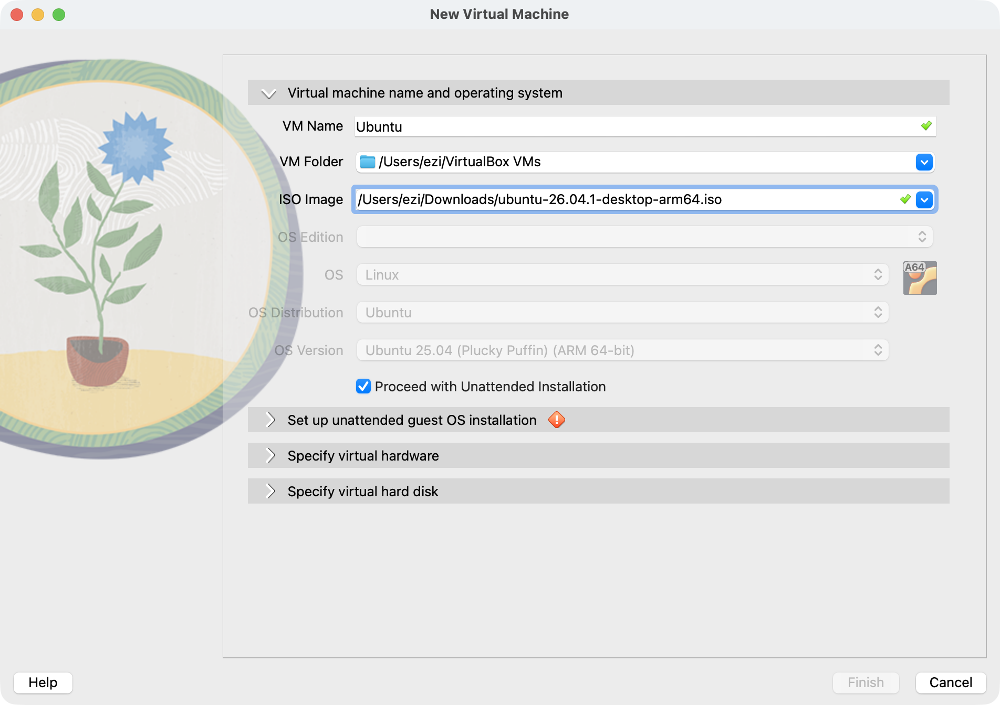

*Figure 3. The first page of the New Virtual Machine dialog, where the VM is named Ubuntu and the ARM64 ISO is selected, and where the Proceed with Unattended Installation box, still checked here, must be cleared before continuing.*

### 3.3 Processors, memory, and disk

Open the section *Specify virtual hardware* and enter the resources chosen in section 2.2, which means 8192 MB of base memory and 4 CPUs, as in Figure 4. Keep *Use EFI* enabled. EFI is the modern firmware that a computer runs before its operating system starts, the successor of the older BIOS, and Ubuntu on ARM64 in particular expects to find it.

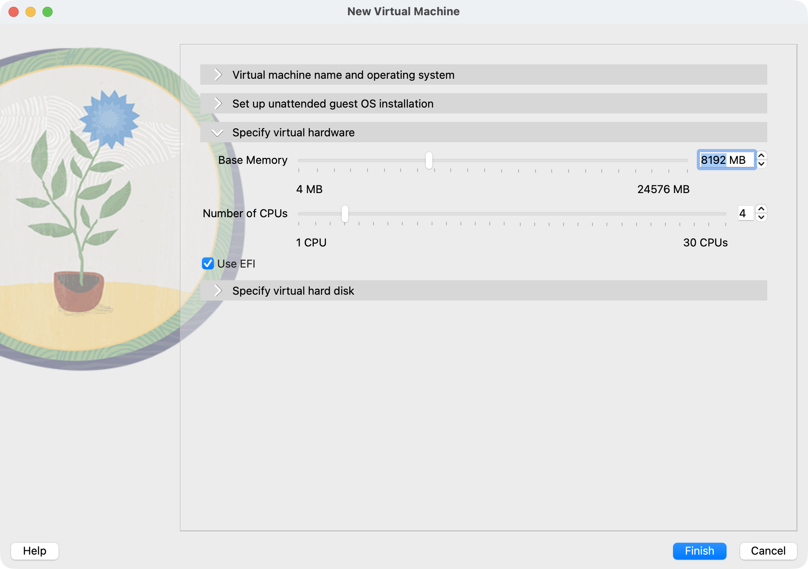

*Figure 4. The virtual hardware section, with 8192 MB of memory, 4 processors, and EFI enabled.*

Next, open *Specify virtual hard disk* and set the size to 60 GB, as in Figure 5. The disk is dynamically allocated, which means that VirtualBox creates a file on your computer that starts small and grows only as Ubuntu actually writes data, up to the 60 GB limit, so a freshly installed VM occupies far less of your real disk than its nominal size suggests.

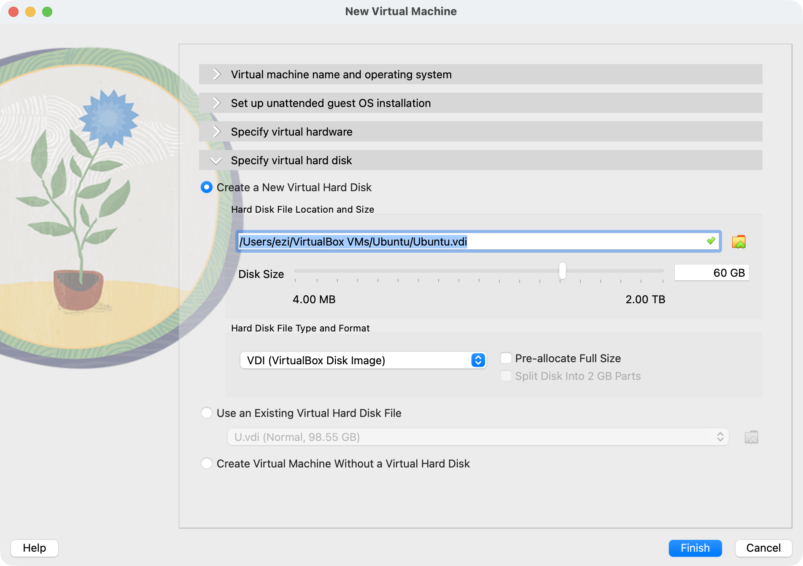

*Figure 5. The virtual hard disk section, where a dynamically allocated 60 GB disk is created for the VM.*

Click *Finish*, and the new machine appears in the VirtualBox Manager, as Figure 6 shows. The details pane is worth reading once, because it confirms each decision made so far, with 8192 MB of memory, four processors, EFI enabled, a 60 GB disk file named `Ubuntu.vdi`, the Ubuntu ISO inserted into a virtual optical drive, and a single network adapter attached to NAT, a setting we return to in section 6.

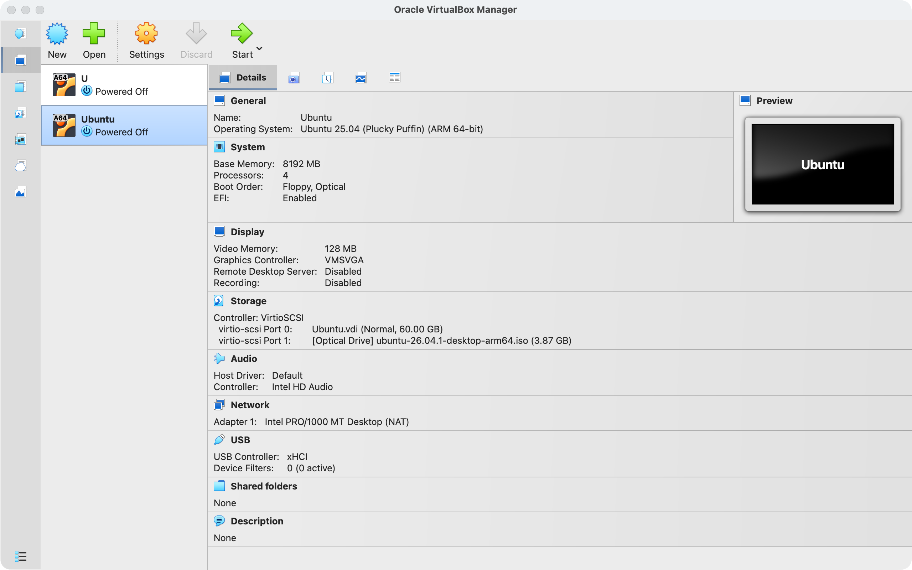

*Figure 6. The new Ubuntu VM in the VirtualBox Manager, powered off, with its memory, processors, disk, installation ISO, and NAT network adapter listed in the details pane.*

Select the VM and click *Start*. VirtualBox opens a window that plays the role of the VM's screen, and the machine boots from the ISO image just as a physical computer would boot from an installation DVD.

## 4. Installing Ubuntu 26.04 LTS

### 4.1 From the boot menu to the installer

The first thing the VM displays is the GRUB menu of the installation image, shown in Figure 7. GRUB is the boot loader that Ubuntu uses to choose what to start, and here it offers a few ways to start the installation medium. Choose *Try or Install Ubuntu* and press Enter.

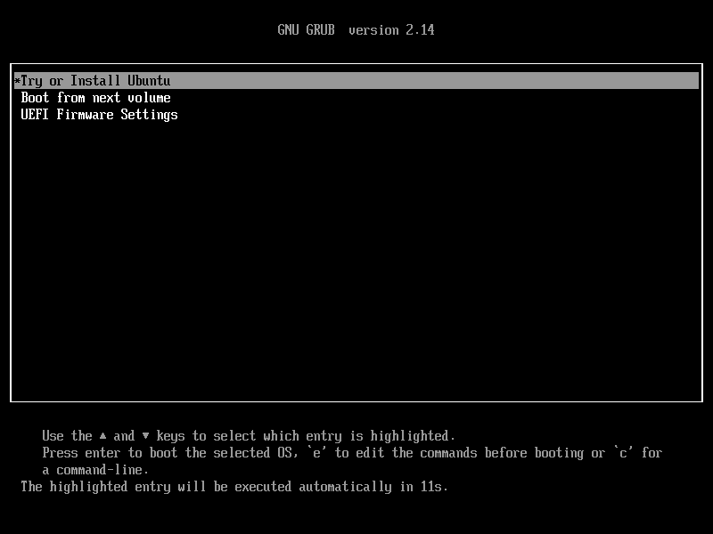

*Figure 7. The GRUB boot menu of the Ubuntu installation image, where Try or Install Ubuntu starts the installer.*

After a short wait the graphical installer appears and guides you through a series of pages. The first four ask for little thought, and Figures 8 to 11 show them in order. You choose the language of the installer and the keyboard layout that matches your physical keyboard, and then the installer reports a wired network connection. That connection is not a cable at all, but the virtual network card VirtualBox provides, which the guest experiences as an Ethernet port with internet access through the host. On the fourth page, choose *Install Ubuntu* rather than *Try Ubuntu*.

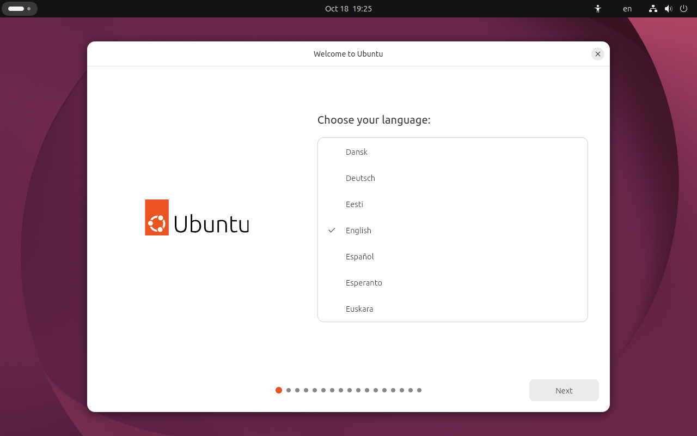

*Figure 8. The language page of the installer.*

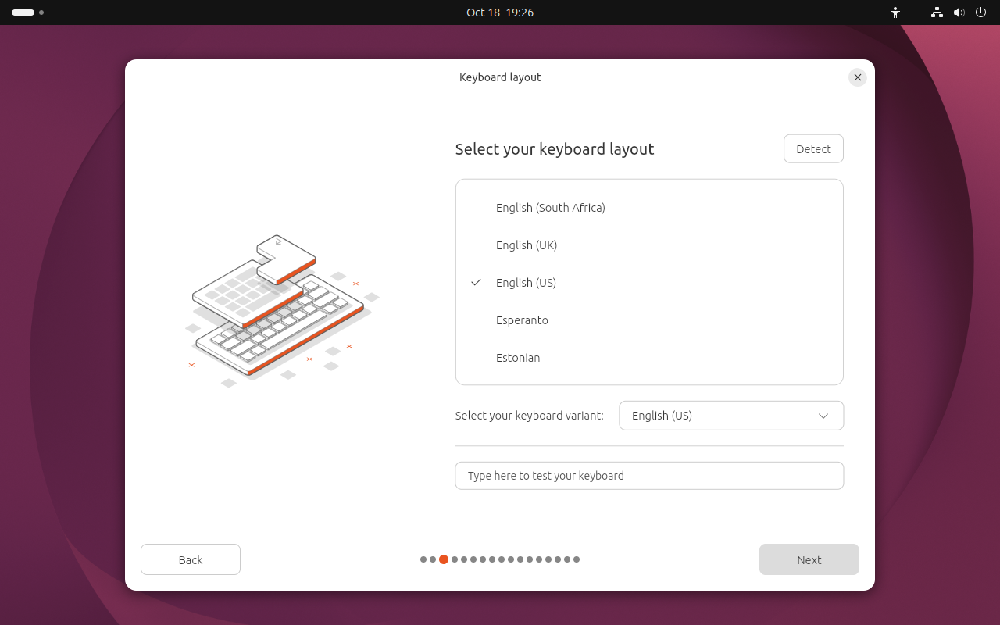

*Figure 9. The keyboard page, where the layout should match the keyboard you actually type on.*

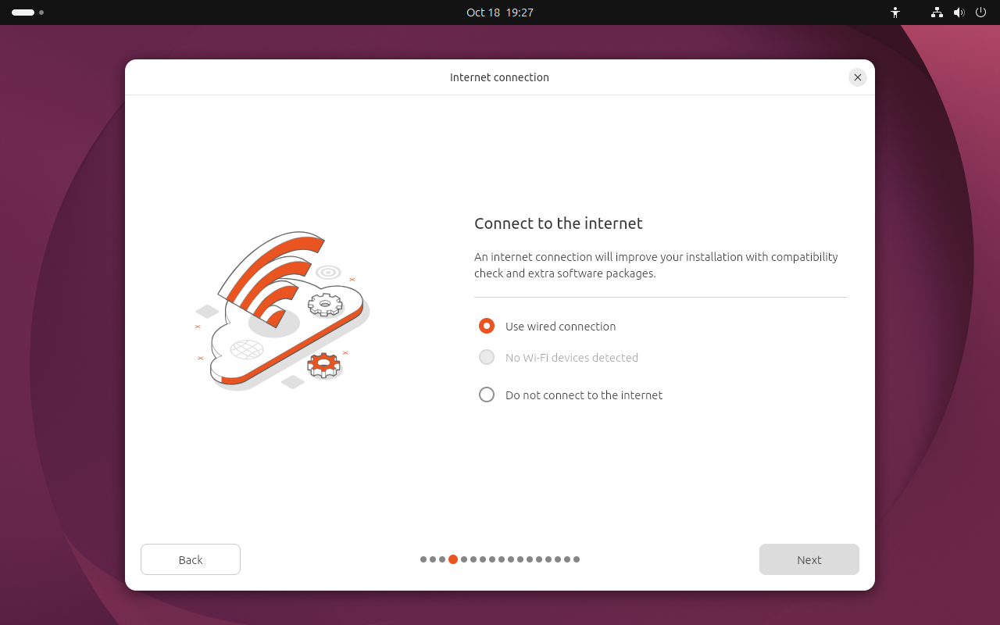

*Figure 10. The network page, which reports a wired connection because the guest sees VirtualBox's virtual network card as an Ethernet port.*

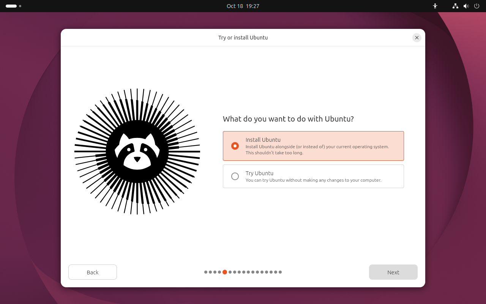

*Figure 11. The page that chooses between trying Ubuntu from the image and installing it, where Install Ubuntu is the correct choice.*

### 4.2 What to install

The next three pages decide what goes onto the disk. Choose *Interactive installation*, shown in Figure 12, which walks through the remaining questions one by one, and then the *Default selection* of applications in Figure 13, which installs the desktop, a browser, and basic utilities without the office tools of the *Extended selection*. The page in Figure 14, titled *Optimise your computer*, offers third-party graphics and Wi-Fi drivers and support for additional media formats. Leave both boxes empty, because the VM has no physical graphics card or Wi-Fi adapter of its own, so such drivers would have nothing to drive.

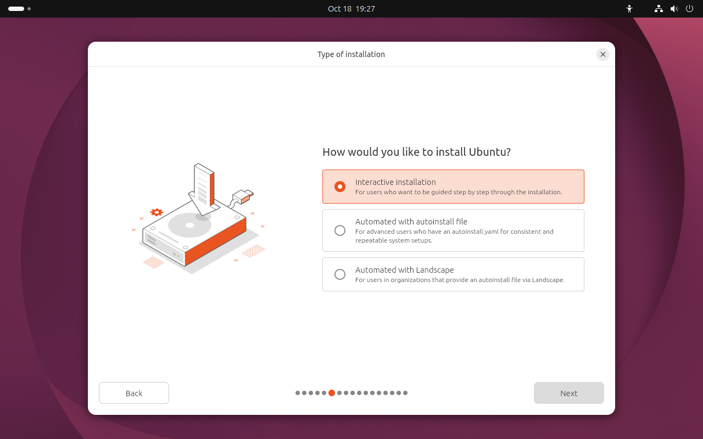

*Figure 12. The installation type page, where Interactive installation lets you make each remaining choice yourself.*

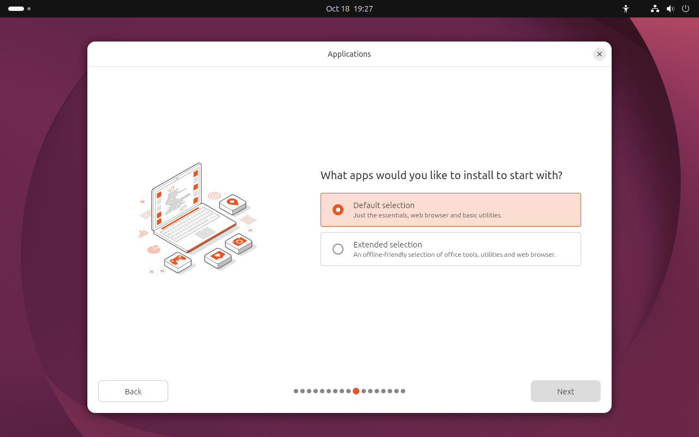

*Figure 13. The applications page, where the Default selection installs a lean desktop.*

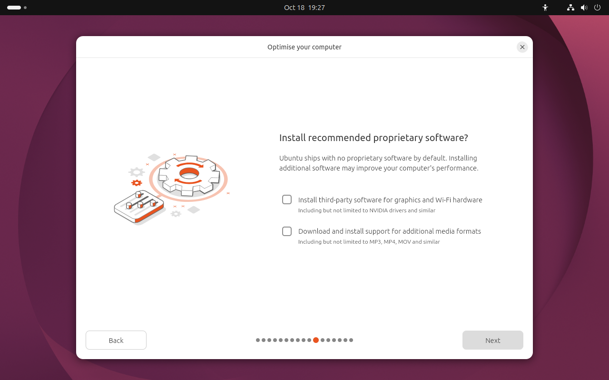

*Figure 14. The page offering proprietary drivers and media codecs, both left unchecked because a VM has no physical graphics or Wi-Fi hardware.*

### 4.3 The disk page and why it is safe

The page in Figure 15 is the one that makes students hesitate, because it offers to *Erase disk and install Ubuntu*, and on a physical computer that sentence would mean losing everything on it. Inside a VM the meaning is different. The only disk the guest can see is the empty 60 GB virtual disk created in section 3.3, which is a file on your host, so erasing it erases only that empty file and cannot reach a single byte of your own data. Choose this option with a clear conscience.

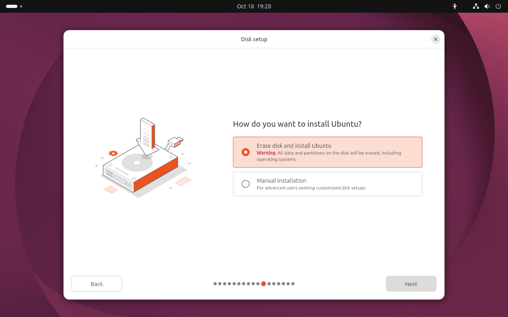

*Figure 15. The disk setup page, where Erase disk and install Ubuntu refers only to the empty virtual disk created for this VM.*

The installer then offers to encrypt the disk, as Figure 16 shows. Encryption protects a laptop that might be stolen, but a lab VM holds no personal data and would ask for an extra passphrase on every boot, so choose no encryption.

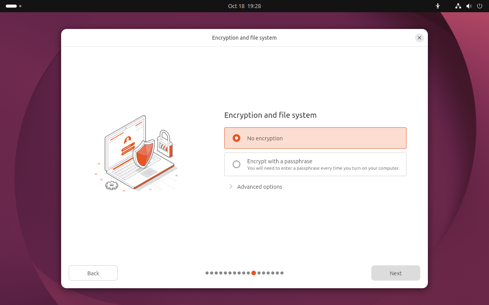

*Figure 16. The encryption page, where no encryption is the sensible choice for a lab VM.*

### 4.4 Account, time zone, and review

On the page in Figure 17, create your user account. The examples in this series use the user name `student` and the computer name `cst8277-vm`, and you will see both in every terminal prompt of the screenshots that follow, in the form `student@cst8277-vm`. You may choose other names, but using the same ones makes it easier to compare your screen with the figures. Choose a password you will remember, since Ubuntu will ask for it whenever a command needs administrator rights.

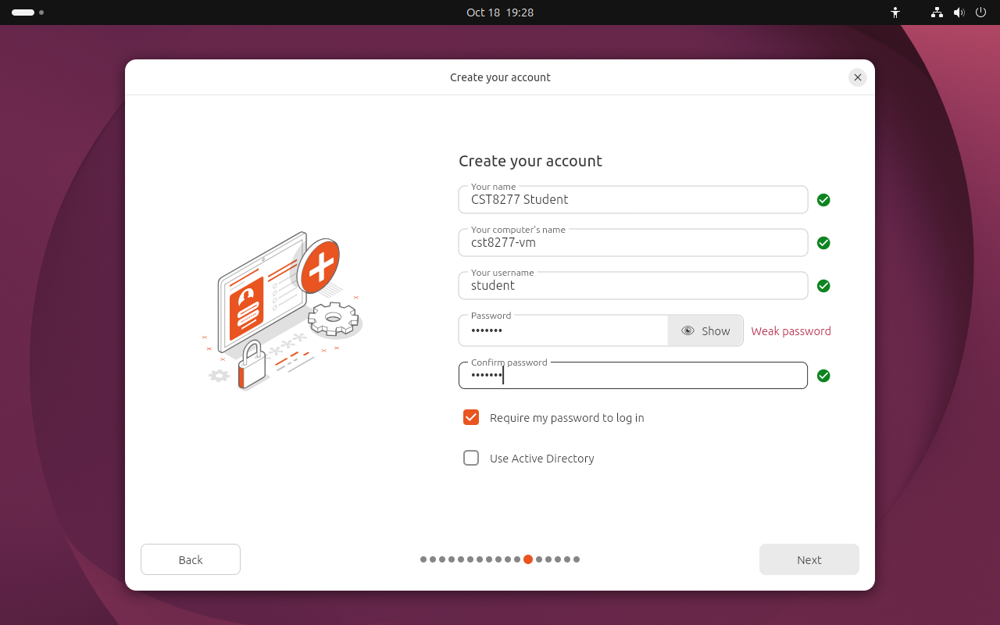

*Figure 17. The account page, where the user student and the computer name cst8277-vm are created.*

Choose your time zone next, as in Figure 18, where Toronto has been selected. The installer then summarizes every choice on a review page, shown in Figure 19, which is the last moment at which anything can be changed without starting over. Read it, and click *Install*.

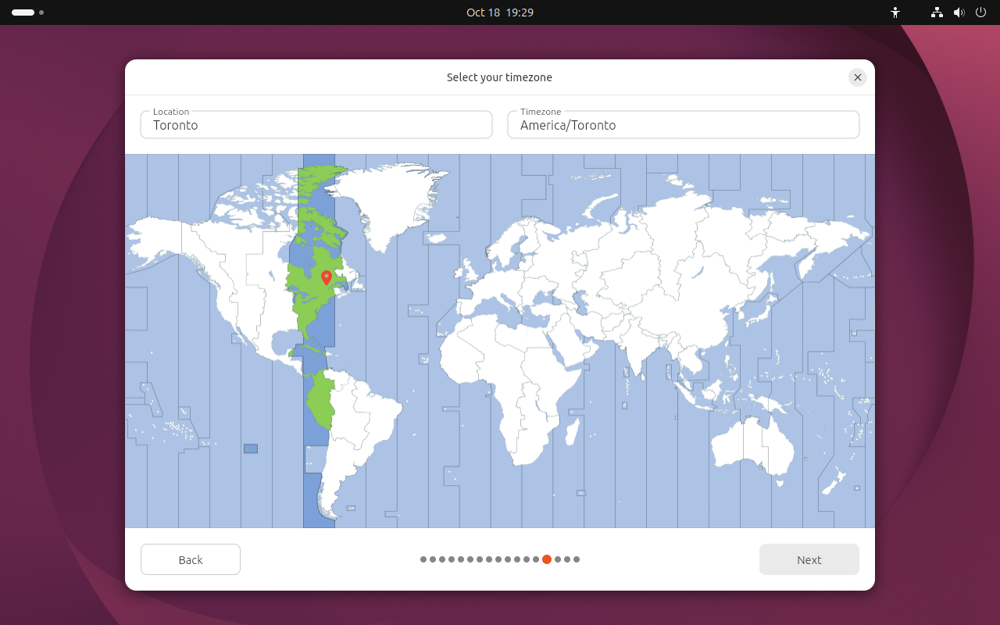

*Figure 18. The time zone page, with Toronto and the America/Toronto zone selected.*

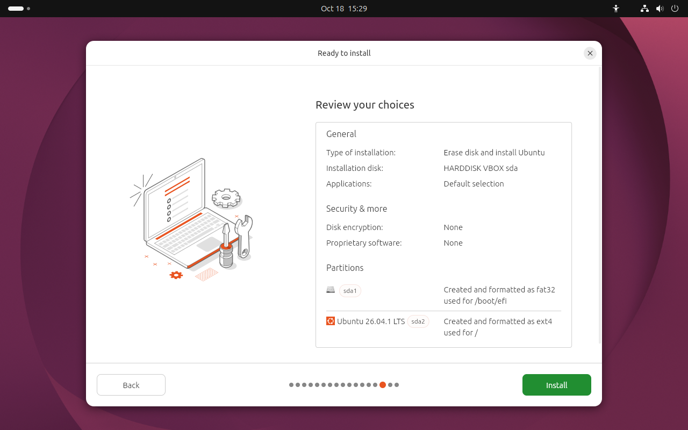

*Figure 19. The review page, which lists every choice made so far before the installation begins.*

The installation takes about ten minutes, during which the installer shows a progress page like the one in Figure 20. When it finishes, it announces that the installation is complete and offers *Restart now*, as in Figure 21.

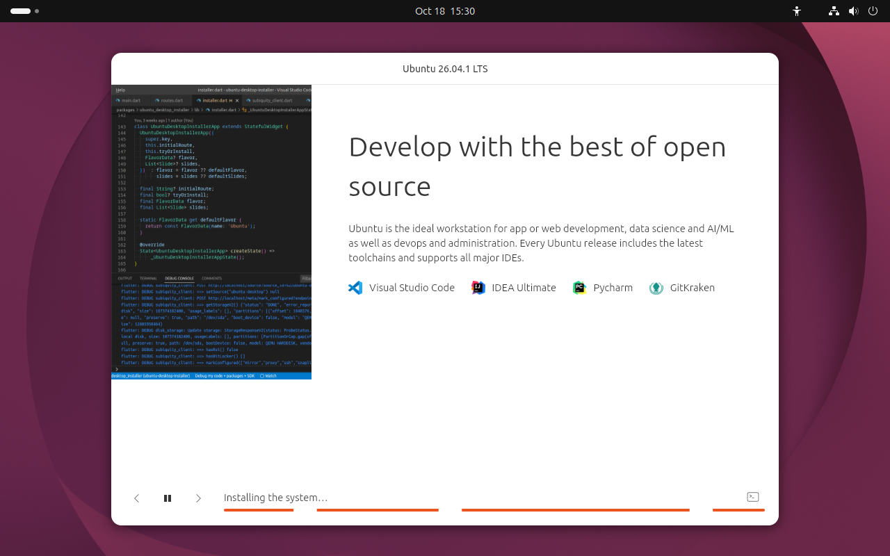

*Figure 20. The installation in progress.*

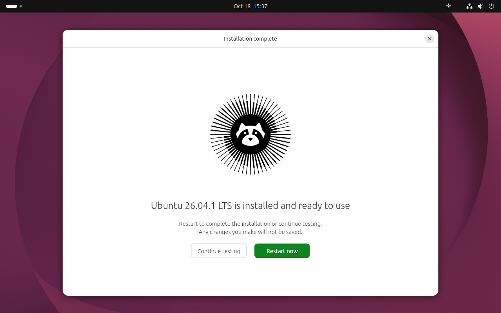

*Figure 21. The installer reporting that the installation is complete, with the Restart now button.*

## 5. The first boot

When you click *Restart now*, the VM shuts down the installer and, before starting again, asks you to remove the installation medium and press Enter, as Figure 22 shows. On a physical computer you would take the DVD out of the drive, which is necessary because otherwise the machine would boot into the installer once more. In VirtualBox there is nothing to remove by hand, because pressing Enter is enough and VirtualBox ejects the virtual DVD by itself.

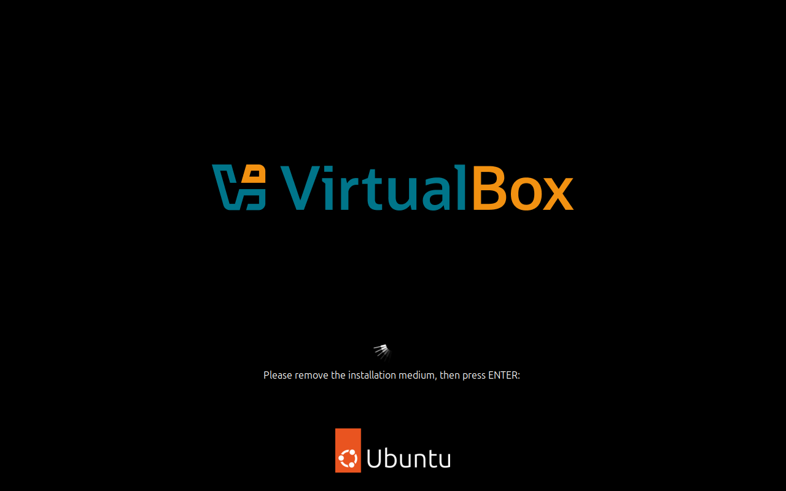

*Figure 22. The request to remove the installation medium, which in VirtualBox only requires pressing Enter.*

Ubuntu now boots from its own virtual disk for the first time and shows the login screen in Figure 23. Log in with the password you chose on the account page.

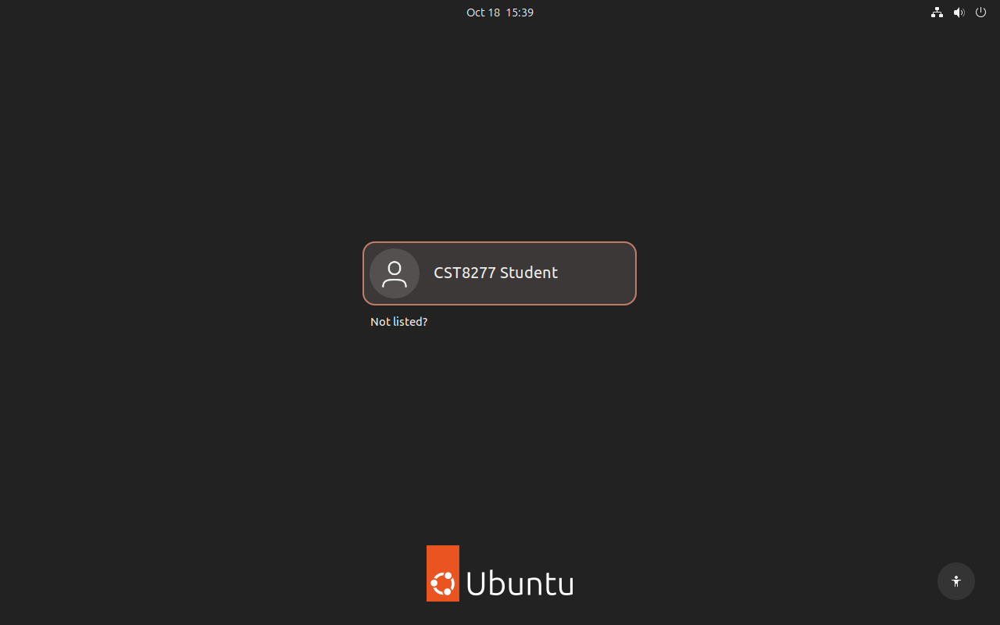

*Figure 23. The Ubuntu login screen with the student account.*

A welcome assistant greets you after the first login, as in Figure 24, and walks you through a few optional settings, which you may accept or skip as you like. In the screenshot a notification has already appeared that 74 updates are available, a reminder that an ISO image is a snapshot of the day it was built and that the packages it installed have been revised many times since.

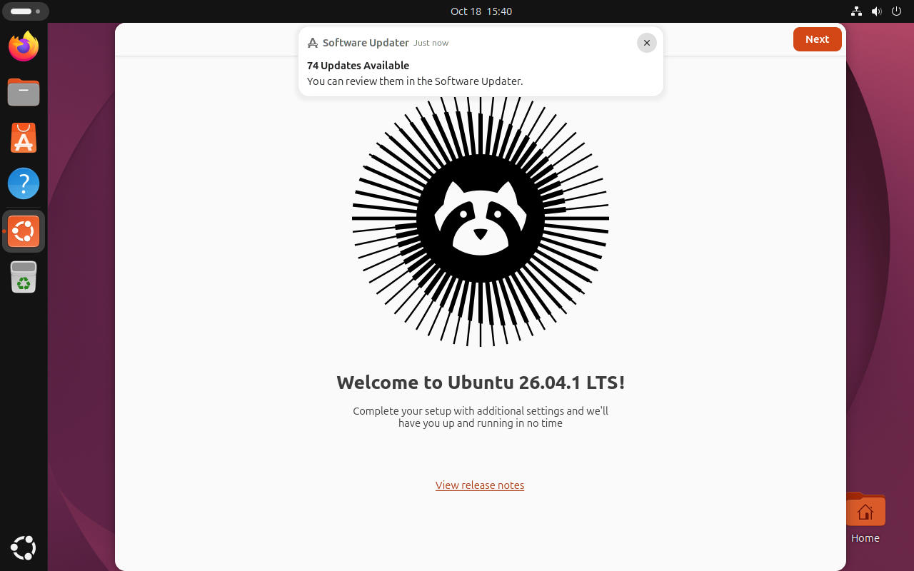

*Figure 24. The welcome assistant of Ubuntu 26.04.1 LTS, with a notification that software updates are already available.*

Once the assistant closes, you have a working Ubuntu desktop, shown in Figure 25, with the dock of applications on the left and, at the bottom of the dock, the button that shows every installed application.

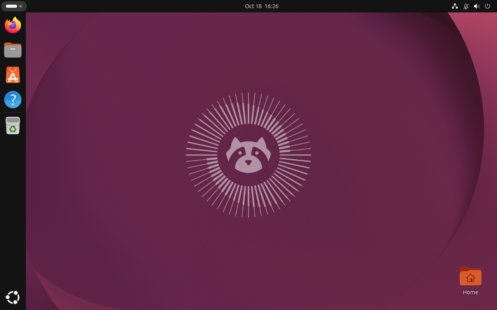

*Figure 25. The Ubuntu 26.04 LTS desktop, ready for use.*

The most important application on that desktop, for the rest of this series, is the terminal, which you open by pressing Ctrl+Alt+T. Its first job is to bring the system up to date. You can accept the updates offered by the Software Updater, or run the two commands below, which first refresh the list of available packages and then install the newer versions of everything already installed.

```bash
sudo apt-get update && sudo apt-get upgrade
```

The word `sudo` in front of each command runs it with administrator rights, which is why Ubuntu asks for your password the first time. The `&&` between the two commands means that the second runs only if the first succeeds, a small habit that prevents a failed update from being followed by an upgrade based on stale information. If the upgrade replaces the kernel, Ubuntu will suggest a restart, and it is worth accepting before you continue.

## 6. Optional work from your own terminal

### 6.1 How the VM reaches the network

The VM window is a perfectly good place to work, but typing long commands into it can be tedious, and copying and pasting between the host and the guest does not always work smoothly. Many students therefore prefer to work from a terminal on their own computer and connect to the VM over SSH, the standard protocol for logging in to a remote Linux machine. Doing so requires one small change to how the VM is connected to the network, and understanding that change also explains how the VM reached the internet during the installation.

The network adapter we saw in Figure 6 is attached to NAT, which stands for Network Address Translation. In this mode VirtualBox acts like the router in a home network, giving the guest a private address of its own, usually 10.0.2.15, and forwarding the guest's outgoing connections to the internet under the host's address. That is why `apt-get`, the snap store, and Docker Hub can all be reached from inside the VM without any configuration. The same arrangement has a consequence that surprises many students, which is that connections cannot be opened in the other direction, from the host to the guest, unless we tell VirtualBox explicitly which port on the host should lead to which port in the guest. Figure 26 shows such a rule, called a port forward, for SSH.

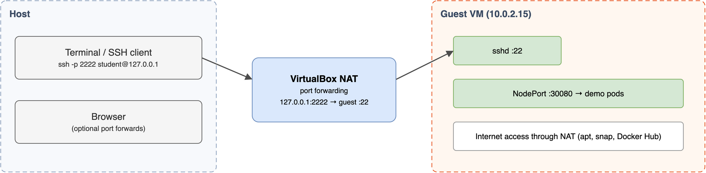

*Figure 26. VirtualBox NAT networking, in which the guest reaches the internet through the host, and a port-forwarding rule from 127.0.0.1:2222 on the host to port 22 in the guest makes SSH possible in the opposite direction.*

### 6.2 Setting up the port forward

There are two equivalent ways to create the rule. In the VirtualBox Manager, open the VM's settings, go to *Network*, then to *Adapter 1 (NAT)*, then to *Port Forwarding*, and add a rule from host address 127.0.0.1 and host port 2222 to guest port 22. Alternatively, while the VM is powered off, run the following command in a terminal on your host.

```bash
VBoxManage modifyvm Ubuntu --natpf1 "ssh,tcp,127.0.0.1,2222,,22"
```

The quoted argument lists, in order, a name for the rule, the protocol, the host address and port, an empty guest address that VirtualBox fills in itself, and the guest port. Binding the rule to 127.0.0.1 rather than to every address of the host means that only programs on your own computer can use the forward, and not other machines on the same Wi-Fi network.

The rule is useless until something inside the guest is listening on port 22, and the default Ubuntu desktop does not include an SSH server. Start the VM, install the server from its terminal, and then connect from a terminal on the host.

```bash
# inside the VM
sudo apt-get install -y openssh-server

# on your own computer
ssh -p 2222 student@127.0.0.1
```

The `-p 2222` option tells the SSH client to use the forwarded port rather than the standard port 22, and VirtualBox carries the connection through to the guest. From here on, every command in this series can be typed either in the VM's own terminal or in this SSH session, whichever you find more comfortable, with the exception of graphical programs such as the browser and the IDE, which must run on the VM's desktop.

## 7. When the VM misbehaves

A VM fails in ways a physical computer does not, and three problems account for most of the trouble students report at this stage. The most common is a VM that is very slow, which almost always means it has too little memory or too few processors for what it is being asked to do. Power the VM off, since VirtualBox refuses to change these settings while it runs, raise the values toward the 4 cores and 8 GB recommended in section 2.2, and start it again. Later in the series, when Kubernetes runs inside the VM, the same shortage shows up as application pods that stay in the Pending state, and the remedy is the same.

The second problem is a VirtualBox window that freezes or a VM that crashes, which is most often caused by an outdated version of VirtualBox on a recently updated host. Updating VirtualBox usually cures it. If the window itself is what freezes, saving the VM's state, or starting the VM headless from the VirtualBox Manager and working entirely over the SSH connection from section 6, sidesteps the problem.

The third problem is the hardest to diagnose, because the VM fails to boot from the installation image, without any message that names the cause. The cause is nearly always an ISO of the wrong edition, AMD64 on an Apple silicon Mac or ARM64 on an Intel or AMD computer, and the remedy is to download the edition that matches the processor, as described in section 2.3, and to select it in the VM's storage settings.

## 8. What you have now

You now have a complete Ubuntu 26.04 LTS computer that runs inside your own, isolated from your files, sized for the work ahead, and reachable both from its own desktop and, if you set up the port forward, from your own terminal. Before moving on, it is worth confirming two things from a terminal in the VM. The first command below prints the name and version of the operating system, which should report Ubuntu 26.04 LTS, and the second shows the size and free space of the root file system, which should be close to the 60 GB you assigned, minus the space the installation already uses.

```bash
lsb_release -a
df -h /
```

The machine is still, in a sense, empty, since it runs a desktop and a browser and nothing that resembles an enterprise application platform. The earlier modules of the course described such a platform in theory, with containers grouped into pods, pods managed by an orchestrator that restarts them when they fail, and services that route traffic to whichever pods happen to be alive. [Part 2](Part%202%20-%20A%20Kubernetes%20Cluster%20of%20Your%20Own.md) installs that orchestrator, Kubernetes, inside the VM we have just built, so that from then on the theory can be watched at work.

## References

- Canonical. (n.d.). *Download Ubuntu Desktop*. Retrieved from https://ubuntu.com/download/desktop
- Oracle. (n.d.). *Oracle VirtualBox downloads*. Retrieved from https://www.virtualbox.org/wiki/Downloads
