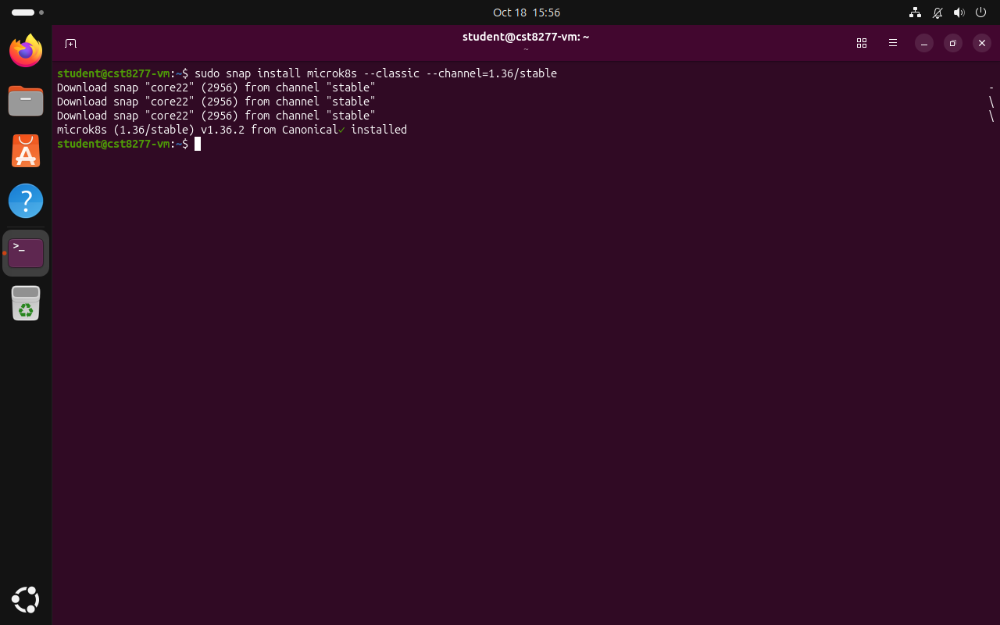
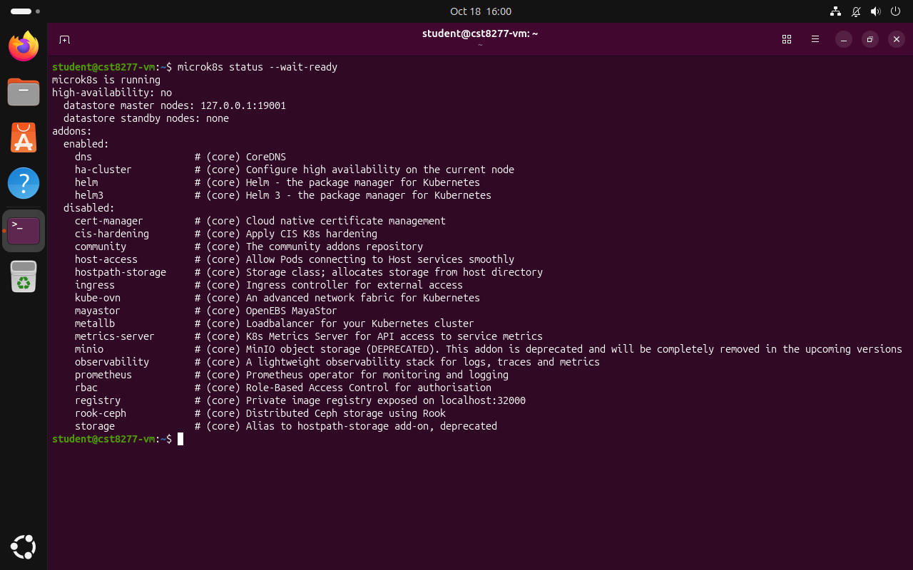
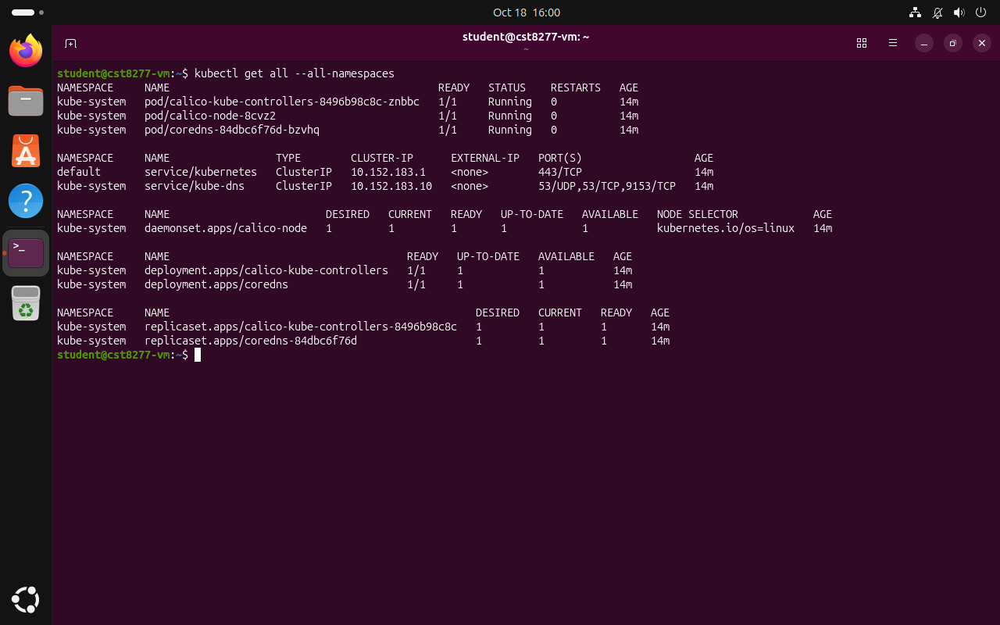
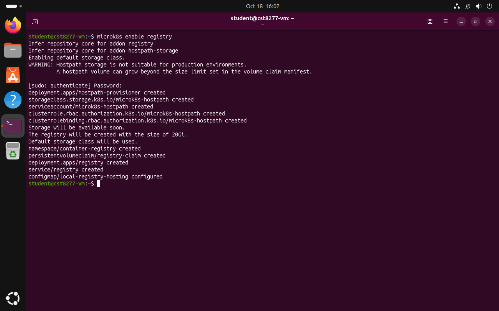
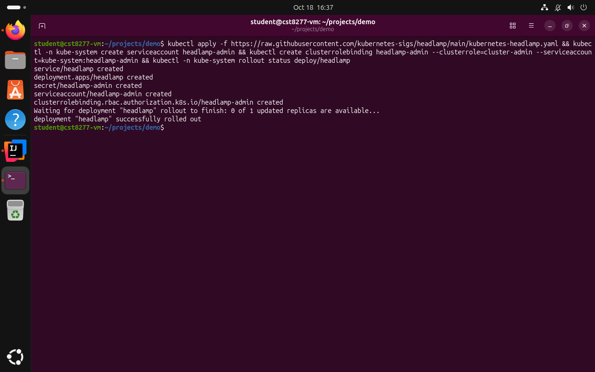
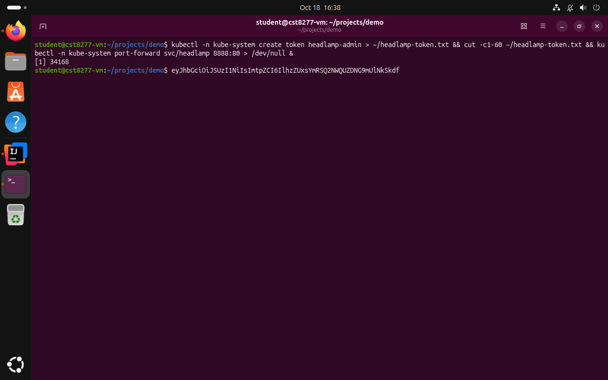
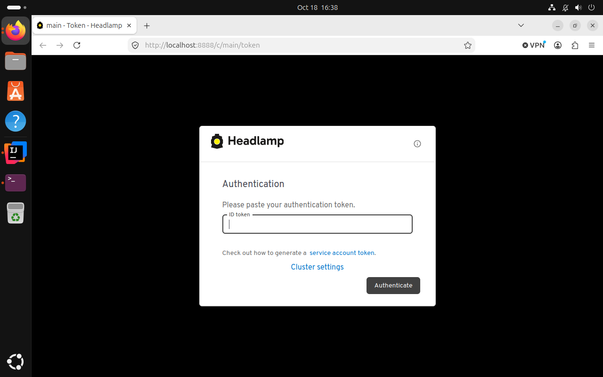

# A Kubernetes Cluster of Your Own

*How to install MicroK8s in the Ubuntu virtual machine, meet the cluster it creates, add a local image registry, and watch everything through Headlamp, the second part of a three-part series for CST8277 Enterprise Application Programming.*

This is Part 2 of 3. [Part 1](Part%201%20-%20A%20Computer%20Inside%20Your%20Computer.md) built the Ubuntu 26.04 LTS virtual machine that this article uses, and [Part 3](Part%203%20-%20From%20Source%20Code%20to%20a%20Running%20Pod.md) deploys our own Spring Boot service onto the cluster built here.

## 1. From running a container to keeping it running

In the module on containerization we ran containers with Docker, one command at a time, and watched each one start, answer a request, and stop. That way of working is perfect for a developer's laptop and hopeless for a production system, because it depends on a person being present at every moment something changes. If a container crashes at three in the morning, nobody restarts it, and if traffic doubles at noon, nobody starts a second copy, so the service is down, or slow, until someone notices.

Kubernetes removes the person from that loop by changing what we tell the system. Instead of issuing commands such as "start this container", we describe the state we want, for example "two copies of this image should always be running and reachable on this port", and Kubernetes compares that description with what is actually running and acts whenever the two differ. A thermostat works on the same principle, since it does not switch the heater on at a particular hour but compares the room's temperature with the one you asked for and acts on the difference, again and again, for as long as it is switched on. Kubernetes runs many such control loops at once, one for each kind of object it manages, and most of what it does can be understood as a loop of this kind noticing a difference and closing it.

The analogy has a limit worth stating now, because students meet it in Part 3. A thermostat cannot repair a broken heater, and Kubernetes cannot repair a broken program either. If an application crashes as soon as it starts, Kubernetes faithfully restarts it, watches it crash again, and keeps restarting it, more slowly each time, which is a symptom to diagnose rather than a fault in Kubernetes.

This article installs a complete Kubernetes cluster inside the virtual machine from Part 1, takes a first look at what is running in it, starts and deliberately damages a small workload to watch the control loop at work, and then adds the two tools that Part 3 needs, an image registry to deliver our own images to the cluster and a graphical interface to watch the cluster from a browser.

## 2. Choosing a Kubernetes that fits on one machine

A production cluster spreads across many machines, called nodes, so that the loss of any one of them does not take the service down. For learning, a single node is enough, and several projects package a full Kubernetes so that it runs on one computer. Minikube, the oldest of them, starts a cluster inside a VM or a container of its own, while kind, whose name abbreviates Kubernetes in Docker, runs each node as a Docker container and is popular in automated test pipelines. K3s is a lightweight distribution packaged as a single binary, aimed at small devices and edge computing, and MicroK8s, from Canonical, the company behind Ubuntu, installs a complete single-node cluster as one snap package.

All four would serve the course, and the choice is made here for convenience. Because our VM already runs Ubuntu, and because the snap system that Ubuntu uses for self-contained packages installs, updates, and removes MicroK8s with one command each, MicroK8s is the shortest path from an empty VM to a running cluster. It also ships optional add-ons, such as the image registry we need later, that are enabled with a single command rather than assembled by hand.

## 3. Installing MicroK8s

Open a terminal in the VM, either on its desktop with Ctrl+Alt+T or through the SSH connection described in Part 1, and run the commands below. The first installs MicroK8s, the second and third give your user account the right to control it without `sudo`, and the last waits until the cluster has started.

```bash
sudo snap install microk8s --classic --channel=1.36/stable
# let your user run microk8s without sudo, then log out and in
sudo usermod -a -G microk8s $USER
mkdir -p ~/.kube && sudo chown -R $USER ~/.kube
microk8s status --wait-ready
```

Each option in the first command has a purpose. The `--classic` flag gives the snap classic confinement, which means full access to the system rather than the sandbox most snaps run in, and Kubernetes needs that access because it manages networking, storage, and processes for everything that runs on the node. The `--channel=1.36/stable` option pins the installation to the stable releases of Kubernetes 1.36, so that automatic snap updates bring security fixes within that version but never move the cluster to a new version in the middle of the term. Figure 1 shows the installation completing.



*Figure 1. MicroK8s 1.36 installed from the snap store.*

The `usermod` command adds your user to the `microk8s` group, the group whose members may control the cluster, and the `~/.kube` directory is where Kubernetes tools keep their configuration, which is why it must belong to you rather than to the administrator account. Group membership, however, is read only when you log in, so the change made by `usermod` does not yet apply to the terminal in which you typed it. Running `microk8s status` in that same terminal fails with the message "Insufficient permissions to access MicroK8s", which looks like the sign of a broken installation but only means that the old login session does not know about the new group.

The cure is to log out of Ubuntu completely and log in again. Older guides suggest the command `newgrp microk8s` as a shortcut, but it is no longer available on Ubuntu 26.04 Desktop, so the full log-out is the reliable way. In the new session, `microk8s status --wait-ready` returns once the cluster is up and prints its state, as Figure 2 shows.



*Figure 2. The output of microk8s status, reporting that MicroK8s is running on a single node, with the dns, ha-cluster, helm, and helm3 add-ons enabled and a long list of others, including registry, available but disabled.*

The output is worth reading line by line. The words "high-availability: no" say what we already know, that a single node cannot survive its own failure. The list of enabled add-ons includes `dns`, which runs CoreDNS, the service that lets programs in the cluster find one another by name, and the long list of disabled add-ons is a catalog of optional features, among them the `registry` add-on that section 6 enables.

## 4. Meeting the cluster

### 4.1 One command for the API

Every interaction with a Kubernetes cluster goes through its API server, and the standard client for that API is a command-line program called `kubectl`. MicroK8s bundles its own copy, invoked as `microk8s kubectl`, which guarantees that client and cluster have matching versions. Since every guide, book, and error message in the Kubernetes world writes plain `kubectl`, it is convenient to define an alias, so that the shorter name works too, and then to ask the cluster what it is running.

```bash
echo "alias kubectl='microk8s kubectl'" >> ~/.bash_aliases
source ~/.bash_aliases
kubectl get all --all-namespaces
```

The first line appends the alias to `~/.bash_aliases`, a file that the Ubuntu shell reads each time a terminal opens, so the alias survives restarts. The second loads it into the terminal that is already open, and the third lists the main objects in every namespace of the cluster, producing the output in Figure 3.



*Figure 3. The objects in a freshly installed cluster, where the kube-system namespace holds the Calico networking components and CoreDNS, each running as a pod, and the default namespace holds only the kubernetes service that leads to the API server.*

### 4.2 Reading the first listing

Although we have not deployed anything yet, the cluster is far from empty, and its contents introduce most of the vocabulary that the rest of the series uses. The first column names a namespace, a label that divides a cluster into separate areas so that system components do not mix with applications. Everything Kubernetes needs to run itself lives in `kube-system`, and our own work goes into `default`.

The smallest objects in the listing are pods. A pod is one or more containers that Kubernetes schedules together, and in practice it is usually a single container wrapped in the information Kubernetes needs to manage it. Three pods are running here. Two of them, `calico-node` and `calico-kube-controllers`, belong to Calico, the networking layer that gives each pod an address of its own and lets pods reach one another, and the third, `coredns`, is the name service mentioned in section 3.

Below the pods, the listing shows the objects that keep them alive, and here the control loop from section 1 becomes visible. A Deployment, such as `deployment.apps/coredns`, records the desired state, which here is one ready copy of the CoreDNS pod. It does not create pods directly but through a ReplicaSet, whose only job is to keep the right number of identical pods running, replacing any that disappear. The `calico-node` pod is managed differently, by a DaemonSet, a controller that runs exactly one copy of a pod on every node, because each node needs its own networking agent. Finally, a Service, such as `service/kube-dns`, gives a stable address to a group of pods, so that clients do not need to know which pods currently exist or where they run.

## 5. A first workload

### 5.1 Starting it

The best way to see the control loop at work is to give it something to do. The commands in this section are not part of the permanent environment, and the section ends by removing everything they create, but they show in a few minutes what Kubernetes does with a workload, using the public `nginx` web server image so that no code of our own is involved yet.

> These commands were not captured in the module's screenshots, so the output you see may differ slightly in names and numbers from the descriptions below. [TODO: verify on VM]

The first command creates a Deployment named `hello` that runs one pod with the `nginx` image, which Kubernetes downloads from Docker Hub. The second waits until that pod is ready, and the third creates a Service that makes the pod reachable from outside the cluster.

```bash
kubectl create deployment hello --image=nginx
kubectl rollout status deployment/hello
kubectl expose deployment hello --type=NodePort --port=80
kubectl get pods,svc -l app=hello
```

The type `NodePort` asks Kubernetes to open a port in the range 30000 to 32767 on every node and to forward traffic arriving there to the pods behind the Service. Because we did not choose a port, Kubernetes picks one at random, and the last command shows which. Its listing contains a line for the Service whose `PORT(S)` column reads something like `80:31234/TCP`, where the number after the colon is the node port. The option `-l app=hello` filters the listing by label, a key and value that `kubectl create deployment` attached to the pods and the Service for us, and labels are also how the Service knows which pods belong to it.

### 5.2 Calling it, breaking it, and watching it heal

With the node port in hand, call the web server, replacing `31234` with the number your own cluster chose.

```bash
curl -s http://localhost:31234 | grep title
```

The answer should be the line `<title>Welcome to nginx!</title>`, taken from the server's default page, which shows that a request from the VM reached a container inside the cluster through the Service. Now comes the instructive part. Delete the pod, as if it had crashed, and list the pods again immediately.

```bash
kubectl delete pod -l app=hello
kubectl get pods -l app=hello
```

A pod is still listed, but its name ends in a different random suffix and its age is a few seconds, because the ReplicaSet noticed that the number of running pods had fallen from one to zero and created a replacement at once. Nobody told it to do so. The desired state still said one pod, the actual state said none, and the controller closed the gap. Changing the desired state works the same way in the other direction, as the next command shows by asking for three copies instead of one.

```bash
kubectl scale deployment hello --replicas=3
kubectl get pods -l app=hello
```

Within seconds three pods are listed, and the Service, which selects pods by label rather than by name, spreads requests across all of them without any further change.

The commands so far have been imperative, each one telling Kubernetes to perform an action, which is convenient for experiments but leaves no record of the intended state other than the cluster itself. In Part 3 we write the desired state down in a YAML file instead, the declarative style that real projects use, because a file can be reviewed, versioned, and applied again on any cluster. For now, remove the experiment so that the cluster is clean.

```bash
kubectl delete deployment,service hello
```

## 6. A registry for our own images

The `nginx` image came from Docker Hub, a public registry, which is a server that stores container images so that Docker and Kubernetes can pull them by name. Our own application, which we build in Part 3, has no place there, and publishing student code to a public registry would be neither necessary nor wise. A cluster can only run images it can pull from some registry, however, so we need a registry of our own, and MicroK8s provides one as an add-on.

```bash
microk8s enable registry      # image registry at localhost:32000
```

Enabling the add-on asks for your password, because it changes system settings, and then reports what it creates, as Figure 4 shows. The registry needs somewhere to keep its images, so MicroK8s first enables the `hostpath-storage` add-on, which stores data in a directory on the node, and warns that this kind of storage is not suitable for production, a warning that is true and harmless for a lab. It then creates a namespace called `container-registry`, a 20 GiB storage claim, and the registry itself, reachable on port 32000.



*Figure 4. Enabling the registry add-on, which asks for the sudo password, enables hostpath storage, and creates a 20 GiB registry in the container-registry namespace.*

From now on, an image whose name begins with `localhost:32000/` refers to this registry. Docker, when we install it in Part 3, will push images there, and Kubernetes will pull them from the same address. Neither program asks for the TLS certificate that a public registry would need, because Docker treats any registry on `localhost` as trusted by default and MicroK8s configures its own container runtime to trust this one address, an arrangement that is acceptable inside a private VM and would not be anywhere else.

## 7. Seeing the cluster with Headlamp

### 7.1 Why a graphical view

The command line shows the cluster one object type at a time, and that is how experienced engineers usually work, but a beginner learns faster when the relationships between objects are drawn on a screen. Earlier versions of this course used the Kubernetes Dashboard for that purpose. The Dashboard project was archived in 2026, and the Kubernetes project now points users to Headlamp, an open-source, extensible web interface that is its official successor ([Kubernetes, 2026](https://kubernetes.io/blog/2026/06/01/dashboard-to-headlamp/)).

### 7.2 Installing and opening Headlamp

Headlamp runs inside the cluster as an ordinary Deployment, so installing it means applying its manifest, the YAML file that describes its objects, straight from the project's repository. Logging in requires an identity, and Kubernetes gives programs and tools an identity called a service account. The commands below create one, grant it full rights over the cluster, issue a login token for it, and finally forward a port of the VM to Headlamp so that a browser can reach it.

```bash
kubectl apply -f https://raw.githubusercontent.com/\
kubernetes-sigs/headlamp/main/kubernetes-headlamp.yaml
# a service account to log in with (lab use only!)
kubectl -n kube-system create serviceaccount headlamp-admin
kubectl create clusterrolebinding headlamp-admin \
    --clusterrole=cluster-admin \
    --serviceaccount=kube-system:headlamp-admin
kubectl -n kube-system create token headlamp-admin
kubectl -n kube-system port-forward svc/headlamp 8888:80
```

A backslash at the end of a line tells the shell that the command continues on the next line, which is how the long URL and the long `clusterrolebinding` command fit on the page. The option `-n kube-system` places the service account in the same namespace as Headlamp, and the cluster role binding attaches the predefined role `cluster-admin`, which permits every action on every object, to that account. The `create token` command prints a long string, the token, which is valid only for a limited time, so when Headlamp later refuses it you run the command again for a new one. The last command keeps running and occupies its terminal for as long as the forward is needed, carrying connections from port 8888 of the VM to port 80 of the Headlamp Service inside the cluster.



*Figure 5. Deploying Headlamp and creating its service account and cluster role binding, captured later in the series, which is why the prompt shows the project folder from Part 3 and the IDE appears in the dock, although the commands work the same from any folder.*



*Figure 6. A variant of the token and port-forward commands that saves the token to a file and runs the port forward in the background, so that the same terminal stays free for further commands.*

Figure 6 shows a variation that some students find more convenient. It writes the token to a file, prints only its first 60 characters as a check, and starts the port forward in the background with `&`, so that it does not occupy the terminal. Either form works, and the plain commands above are easier to read when you meet them for the first time.

With the port forward running, open Firefox in the VM, go to `http://localhost:8888`, and paste the token into the login page shown in Figure 7.



*Figure 7. The Headlamp login page, which accepts the service-account token printed by kubectl create token.*

After logging in you see the cluster overview, with the health of the single node and of the pods that section 4 listed from the command line, and a navigation bar for workloads, network objects, storage, and the cluster map. At this stage the picture is quiet, with only the system pods, the registry, and Headlamp itself, and Part 3 returns to it once our own application is running, so the screenshots of those pages appear there.

### 7.3 A warning about the cluster-admin binding

The binding created above gives anyone holding the token complete control of the cluster, including the ability to read every secret and delete every object. On a personal lab cluster inside a VM that nobody else can reach, that convenience is reasonable. On a shared or production cluster it would be a serious security hole, and such clusters grant each person and tool only the permissions their work requires. Module 10 of the course treats access control properly.

## 8. When the cluster misbehaves

Two problems account for most of the trouble at this stage. The first, the message "Insufficient permissions to access MicroK8s", appears in every terminal opened before you logged out and back in after the `usermod` command, and it disappears in a new session, as section 3 explained. The second is pods that remain in the Pending state for a long time, which means that Kubernetes cannot find a node with enough free memory or processor time to run them. On a single-node cluster that node is the VM itself, so the remedy is the one given in Part 1, to power off the VM, give it more memory or processors, and start it again, or, when an application is involved, to run fewer replicas of it.

A third problem looks alarming but is entirely expected. When the VM restarts, the port forward to Headlamp ends with it, and the browser reports that the connection to `localhost:8888` was refused. Headlamp is still installed and running in the cluster, so the remedy is to run the `port-forward` command again and, if the token has expired, to create a new one.

## 9. What comes next

The VM from Part 1 now holds a working Kubernetes cluster. It runs a network layer and a name service, can host workloads that heal themselves and scale on request, keeps a private registry ready to receive images, and can be inspected through a browser as easily as from the command line. Every image the cluster has run so far, however, was written by somebody else. [Part 3](Part%203%20-%20From%20Source%20Code%20to%20a%20Running%20Pod.md) closes that gap by installing a Java toolchain, Docker, and an IDE, writing a small Spring Boot service, packaging it as an image, pushing that image to the registry we have just created, and deploying it with a YAML file, so that the self-healing we watched with `nginx` happens to code of our own.

## References

- Canonical. (n.d.). *MicroK8s documentation*. Retrieved from https://microk8s.io/docs
- Kubernetes. (2026, June 1). *From Kubernetes Dashboard to Headlamp: Understanding the transition*. Retrieved from https://kubernetes.io/blog/2026/06/01/dashboard-to-headlamp/
- Kubernetes SIGs. (n.d.). *Headlamp documentation*. Retrieved from https://headlamp.dev/docs/latest/
